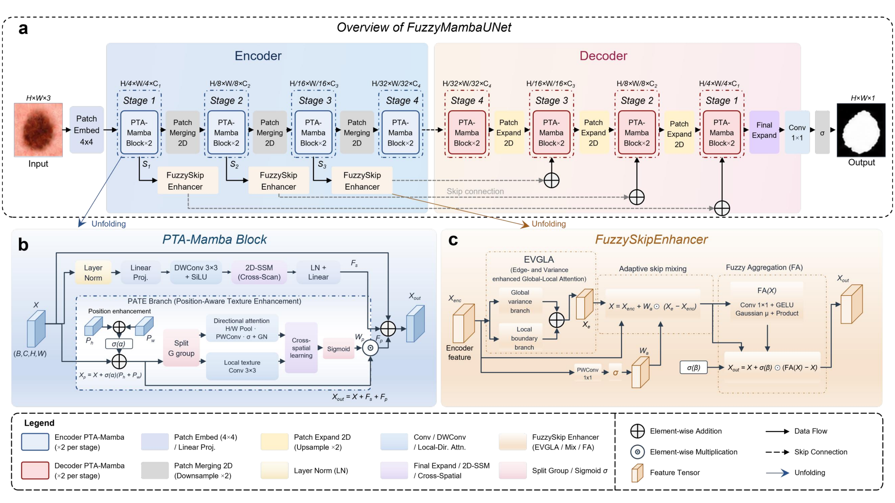
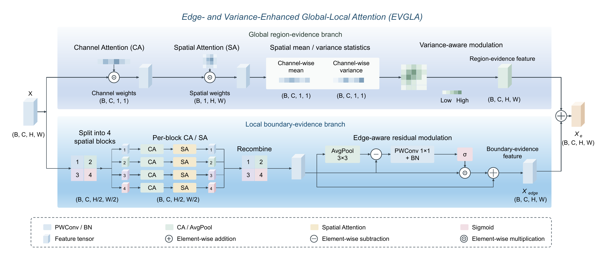
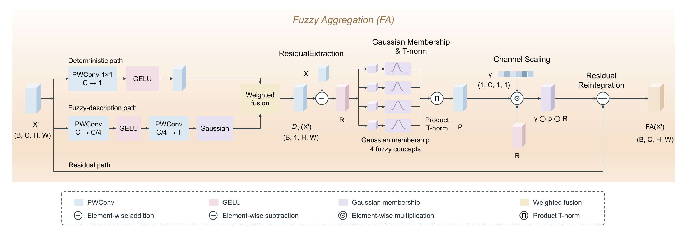

# FuzzyMambaUNet

Code for **FuzzyMambaUNet: Uncertainty-Guided Fuzzy Feature Reasoning with State Space Models for Skin Lesion Segmentation**.

FuzzyMambaUNet combines visual state space modeling, position-aware texture enhancement, and fuzzy skip-feature refinement for skin lesion segmentation.

## Overview



The encoder–decoder uses PTA-Mamba blocks to combine long-range context with local texture information. FuzzySkipEnhancer refines skip features through EVGLA and FA before decoder fusion.

### Edge- and Variance-Enhanced Global-Local Attention (EVGLA)



EVGLA combines global region evidence with local boundary evidence through variance-aware and edge-aware feature enhancement.

### Fuzzy Aggregation (FA)



FA separates principal and residual features, evaluates residual compatibility with learnable Gaussian memberships, and uses product aggregation to modulate residual reintegration.

## Installation and Setup

### 1. Hardware and System Requirements

| Component | Requirement |
|---|---|
| Operating system | Linux |
| GPU | NVIDIA GPU with CUDA support |
| Reference GPU | NVIDIA GeForce RTX 4090, 24 GB |
| Python | 3.8 |
| CUDA toolkit | 11.7 |
| Framework | PyTorch |

### 2. Install Required Packages

Run the following commands from the project root:

```bash
conda create -n fmu python=3.8 -y
conda activate fmu
sh scripts/install_environment.sh
```

### 3. Prepare the Dataset

Organize the ISIC2018 images and segmentation masks as follows:

```text
experiments/val189/data/isic2018/
├── train/
│   ├── images/
│   └── masks/
├── val/
│   ├── images/
│   └── masks/
└── test/
    ├── images/
    └── masks/
```

## Model Training

```bash
python train_diagnostic.py \
  --config experiments/val189/config.json \
  --output experiments/val189/runs/seed_n \
  --seed n
```

## Model Testing

Evaluate the selected checkpoint on the test split:

```bash
python tools/test.py \
  --checkpoint experiments/val189/runs/seed_n/best.pth \
  --output results/seedn_test \
  --save-predictions
```
